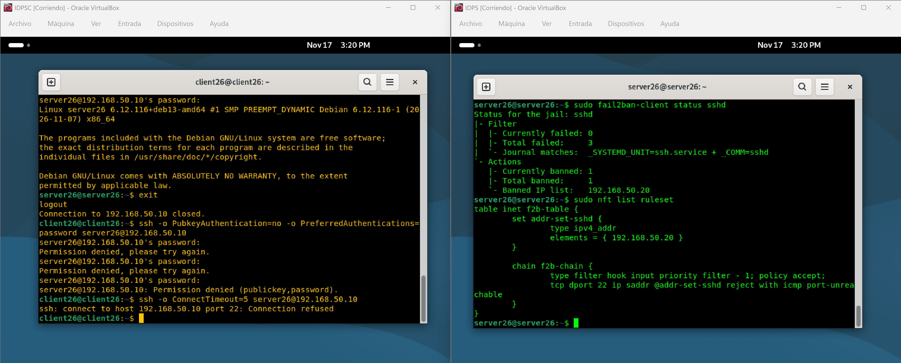

# SSH Intrusion Prevention

## Implementation
Installed OpenSSH and Fail2Ban on the IDPS server to detect repeated failed SSH authentication attempts and automatically block suspicious IP addresses using nftables.

## Fail2Ban Configuration

File: **/etc/fail2ban/jail.local**

```ini
[DEFAULT]
bantime = 10m
findtime = 5m
maxretry = 3
banaction = nftables-multiport

[sshd]
enabled = true
port = ssh
backend = systemd
```

## Security Validation

Three failed SSH authentication attempts from IDPSC (**192.168.50.20**) triggered an automatic IP ban.

- **Detection:** Fail2Ban identified 3 failed authentication attempts.
- **Prevention:** nftables blocked the client IP on TCP port 22.
- **Result:** Subsequent SSH connections were rejected.

